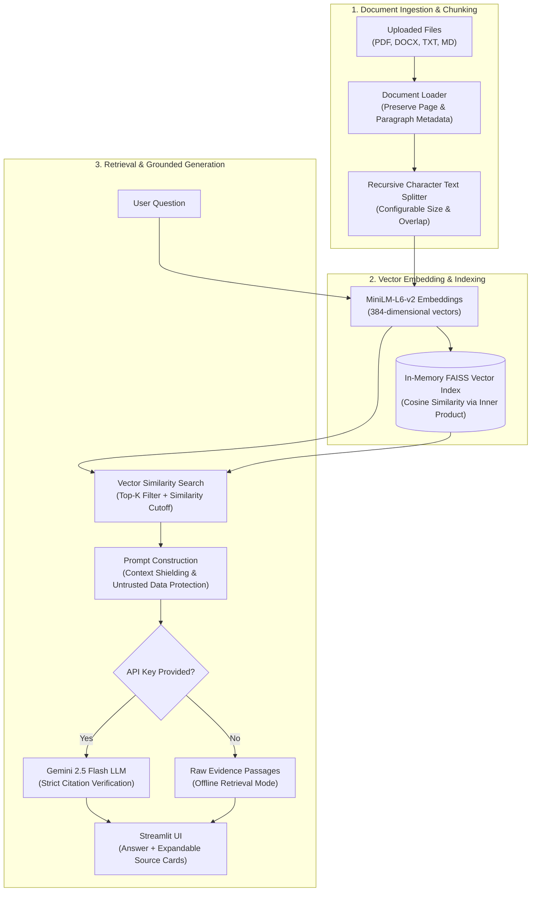

# 📚 DocuMind AI

<p align="center">
  
  
  
  
  
  
</p>

<p align="center">
  <strong>A lightweight, privacy-first Retrieval-Augmented Generation (RAG) platform with strict citation verification and in-memory vector search.</strong>
</p>

---

## 🌟 Overview

**DocuMind AI** allows users to interactively search, analyze, and query document collections using natural language. Built for speed, privacy, and accuracy, it combines local dense semantic embeddings with **Google Gemini 2.5 Flash** for grounded question answering with verified inline citations.

If no API key is provided, the application gracefully operates in **Offline Retrieval Mode**, serving relevant document excerpts with exact similarity metrics without transmitting data to any external service.

---

## ✨ Key Features

- **Multi-Format Document Parsing:** Ingests **PDF**, **Word (.docx)**, **Plain Text (.txt)**, and **Markdown (.md)** files while preserving structural context (exact page numbers, paragraphs, and tables).
- **In-Memory Semantic Search:** Uses `sentence-transformers/all-MiniLM-L6-v2` for 384-dimensional dense embeddings paired with **FAISS** (Facebook AI Similarity Search) cosine similarity indexing. No external vector database infrastructure required.
- **Strict Citation Grounding:** Generates answers strictly grounded in retrieved evidence with citation tags (`[1]`, `[2]`). Automatically verifies citation existence and rejects hallucinated references.
- **Transient Fault Tolerance:** Built-in exponential backoff retry mechanism for resilient handling of LLM endpoint rate limits or server spikes.
- **Offline / Hybrid Mode:** Functions as an offline semantic search engine when no API key is configured.
- **Interactive Web Interface:** Streamlit UI featuring dynamic sliders for chunk size, chunk overlap, top-$k$ retrieval count, and similarity threshold. Includes one-click **"Summarize key topics"**, chat history export, and expandable source evidence cards.
- **Evaluation Benchmark:** Automated evaluation suite measuring **Hit Rate@K**, **MRR@K (Mean Reciprocal Rank)**, **Passage Precision**, and latency.

---

## 🏛️ System Architecture



---

## 📁 Repository Structure

```
DocuMind-AI/
├── .github/
│   └── workflows/
│       └── tests.yml          # GitHub Actions automated test workflow
├── .streamlit/
│   └── config.toml            # UI theme and upload size limits
├── data/
│   ├── documents/
│   │   └── cs_notes.txt       # Sample document for testing and demo
│   └── evaluation.json        # Ground-truth QA benchmark dataset
├── evaluation/
│   ├── evaluate.py            # Retrieval benchmark evaluator (Hit Rate, MRR)
│   └── README.md              # Evaluation guidelines & optional RAGAS notes
├── src/
│   ├── __init__.py
│   ├── documents.py           # Document extraction & recursive chunking
│   ├── rag.py                 # Grounded generation, citation check & retry
│   └── retrieval.py           # Sentence-Transformers + FAISS index engine
├── tests/
│   ├── test_rag.py            # Unit tests for QA logic & citations
│   └── test_retrieval.py      # Unit tests for chunking & vector search
├── .env.example               # Environment variables template
├── .gitignore                 # Excludes .venv, .env, and caches
├── app.py                     # Streamlit web application
├── LICENSE                    # MIT License
├── README.md                  # Project documentation
├── requirements.txt           # Core production dependencies
└── requirements-dev.txt       # Development and testing tools
```

---

## 🚀 Quickstart Guide

### Prerequisites
- Python **3.11** or **3.12** recommended.
- Internet connection on first run to download the embedding model (~80 MB).
- *(Optional)* [Google AI Studio Gemini API Key](https://aistudio.google.com/apikey).

### 1. Clone the Repository
```bash
git clone https://github.com/ROHITH-NATHANI/DocuMind-AI.git
cd DocuMind-AI
```

### 2. Set Up Virtual Environment

**Windows (PowerShell):**
```powershell
py -3.12 -m venv .venv
.\.venv\Scripts\Activate.ps1
```
*(If PowerShell restricts script execution, run `Set-ExecutionPolicy -Scope Process -ExecutionPolicy Bypass`)*

**macOS / Linux:**
```bash
python3.12 -m venv .venv
source .venv/bin/activate
```

### 3. Install Dependencies
```bash
pip install -r requirements.txt
```

### 4. Configure Environment
Copy the example environment file:
```bash
# Windows
Copy-Item .env.example .env

# macOS / Linux
cp .env.example .env
```
Open `.env` and add your Gemini API key (optional):
```env
GEMINI_API_KEY=your_gemini_api_key_here
GEMINI_MODEL=gemini-2.5-flash
```
*(You can also leave it blank and provide the key directly in the web UI sidebar).*

### 5. Launch the Application
```bash
streamlit run app.py
```
Open your browser at **`http://localhost:8501`**.

---

## 🧪 Testing & Evaluation

### Run Unit Tests
```bash
pip install -r requirements-dev.txt
pytest -q
```

### Run Benchmark Evaluation
Evaluate retrieval performance across the included benchmark dataset:
```bash
python -m evaluation.evaluate --k 3
```
This generates an `evaluation/results.json` report containing:
- **Hit Rate@K**
- **MRR@K (Mean Reciprocal Rank)**
- **Mean Passage Precision**
- **Average Retrieval Latency (ms)**

---

## 🔒 Privacy & Security

- **In-Memory Storage:** Uploaded files and vector indices are held in session memory and never saved to permanent disk storage.
- **Untrusted Context Isolation:** Prompts treat document text strictly as untrusted data, mitigating prompt injection vulnerabilities from malicious document contents.
- **Safe Secrets Handling:** API keys and `.env` files are ignored by `.gitignore` to prevent credential leakage.

---

## 📄 License

This project is licensed under the [MIT License](LICENSE).

---

<p align="center">
  Developed by <strong><a href="https://github.com/ROHITH-NATHANI">Nathani Rohith</a></strong>
</p>
